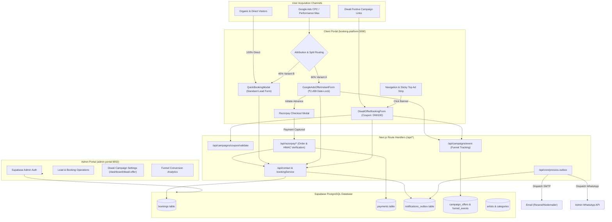
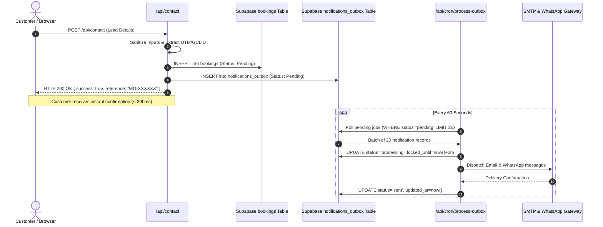
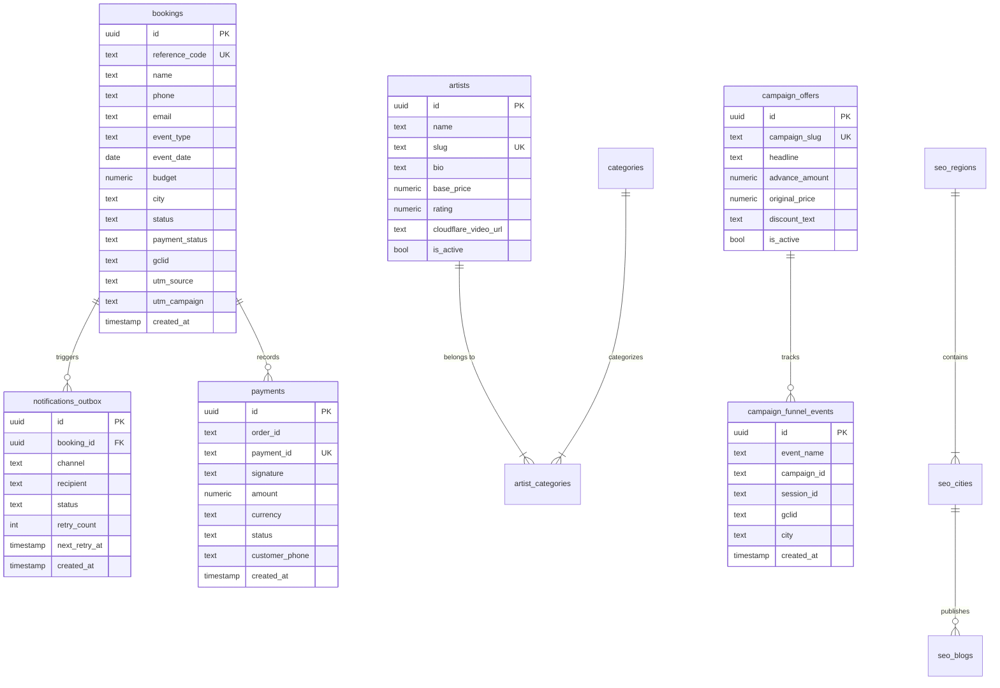
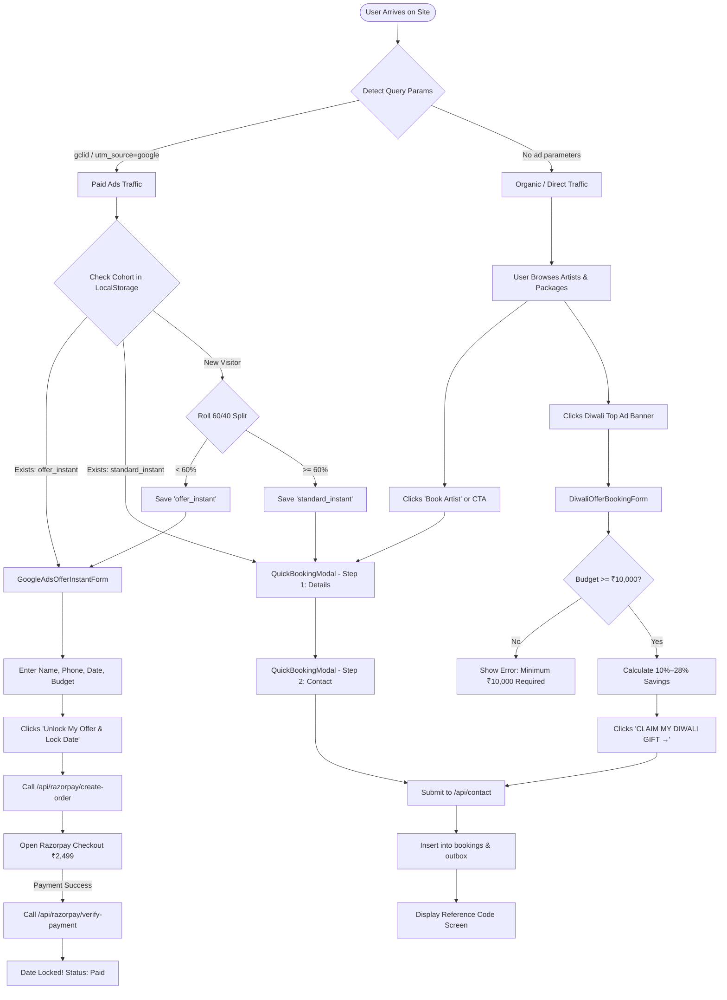
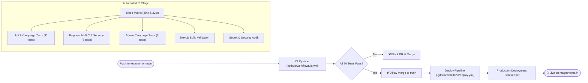

# 🌌 Magnevents — Complete Technical Architecture & Codebase Documentation

> **Single Source of Truth** for the Magnevents Live Musical Talent Booking Ecosystem
> **Production Platform:** [https://magnevents.in](https://magnevents.in)
> **Version:** 2.0.0 (Production-Ready)


> **Target Production Branch:** `main`
> **Active Campaign:** Diwali Special Offer (Coupon: `DIW100` • Progressive 10%–28% Savings • Min. Booking: ₹10,000)


---

## 1. Project Overview

**Magnevents** is a state-of-the-art, high-conversion online platform engineered for booking India's finest live musical performers, acoustic vocalists, Sufi rock bands, instrumentalists, anchors, and celebrity artists for luxury house parties, corporate galas, high-profile weddings, and intimate private gatherings.

Prior to Magnevents, booking live performance talent across major Indian metropolitan hubs (Delhi NCR, Mumbai, Bengaluru, Hyderabad, Jaipur, Pune, Varanasi, Chandigarh) suffered from opaque middleman markups, unverified artist reliability, lack of date-locking security, and broken customer communication channels.

Magnevents solves this through a dual-application monorepo architecture:

1. **Client Booking Portal (`booking-platform`):** A lightning-fast, visually captivating Next.js application tailored for luxury aesthetic immersion, instant artist discovery, dynamic Google Ads campaign routing, and instant advance slot reservation.
2. **Operations & Admin CMS (`admin-portal`):** An enterprise-grade management portal providing real-time lead ingestion, dynamic campaign toggling, automated artist cataloging, conversion analytics, and transactional notification monitoring.

The platform is backed by a transactional Supabase PostgreSQL database, Razorpay payment gateway integration, Cloudflare R2 media storage, Cloudflare Stream video infrastructure, and an automated background notification outbox engine.



---

## 2. Project Objectives

### Business Objectives

* **Elimination of Intermediaries:** Provide clients direct access to curated, verified musical artists with zero broker commissions and transparent pricing.
* **Instant Date-Lock Guarantee:** Enable clients to secure artists on peak calendar dates (Diwali, New Year's Eve, Wedding Season) through a micro-advance token deposit (₹2,499) backed by a 100% artist arrival guarantee.
* **Maximized Advertising ROI:** Accurately attribute Google Ads traffic (`gclid`, `gbraid`, `wbraid`) and run high-converting A/B split-funnel routing without disrupting the experience of organic visitors.
* **Festive Campaign Monetization:** Drive seasonal booking surges through tiered discount engines (such as the Diwali Special Offer `DIW100`), incentivizing higher booking budget values.
* **Lead Ingestion Zero-Loss:** Guarantee that 100% of lead inquiries and date reservations are permanently persisted in the database and immediately delivered to concierges via Email and WhatsApp.

### Technical Objectives

* **Sub-Second Performance & Fluidity:** Achieve sub-100ms UI interactions using Next.js App Router, server-rendered landing pages, and GPU-accelerated Glassmorphism design tokens.
* **Zero External Test Overhead:** Run comprehensive automated testing suites in under 200 milliseconds using Node.js native test runner (`node --test`).
* **Bulletproof Payment Security:** Validate all payment transactions using cryptographic HMAC SHA256 signature verification to prevent order spoofing or price tampering.
* **Fault-Tolerant Outbox Pattern:** Decouple lead capture from third-party notification delivery, ensuring transient email or WhatsApp API downtime never fails a customer's booking request.
* **Programmatic SEO Scalability:** Automatically serve localized dynamic landing pages across dozens of Indian cities with structured schema markup.

---

## 3. Technology Stack

| Layer                            | Technology                   | Version                                  | Purpose                                                                        |
| :------------------------------- | :--------------------------- | :--------------------------------------- | :----------------------------------------------------------------------------- |
| **Client Frontend**        | Next.js App Router           | `14.2.15`                              | Core client application framework, SSR landing pages, API route handlers       |
| **Admin Frontend**         | Next.js App Router           | `15.0.0`                               | Operations dashboard, campaign CMS, analytics visualizations                   |
| **UI Library**             | React                        | `18.3.1` (Client) / `19.0.0` (Admin) | Declarative UI rendering, hooks, component composition                         |
| **Client Styling**         | Vanilla CSS + Design Tokens  | Custom                                   | HSL color system, Glassmorphism, floating glow orbs, zero runtime CSS overhead |
| **Admin Styling**          | Tailwind CSS + shadcn/ui     | `3.4.1`                                | Utility-first styling, Radix UI accessible primitives                          |
| **Database**               | Supabase PostgreSQL          | `15.x`                                 | Relational schema, Row Level Security (RLS), real-time subscriptions           |
| **Payment Gateway**        | Razorpay Node SDK & Checkout | `2.9.4`                                | Instant date-lock slot reservation (₹2,499), webhook processing               |
| **Media Storage**          | Cloudflare R2                | S3 API                                   | S3-compatible cloud object storage for high-resolution artist photography      |
| **Video Infrastructure**   | Cloudflare Stream / YouTube  | HLS Stream                               | Ultra-low latency video reel delivery and artist audition showcase             |
| **Email Service**          | Resend & Nodemailer          | `6.9.15`                               | Transactional HTML email dispatch to customers and operations concierges       |
| **WhatsApp Notifications** | WhatsApp Cloud API / Webhook | REST                                     | Instant admin mobile notification on lead submission                           |
| **Testing Framework**      | Native Node.js Test Runner   | Node 20+ (`node --test`)               | High-speed unit, payment HMAC, security, and campaign testing                  |
| **CI/CD**                  | GitHub Actions               | Workflows v4                             | Multi-job automated testing, secret audit, linting, production gatekeeper      |

---

## 4. Complete Repository Structure

```text
magnevents/
├── .github/
│   └── workflows/
│       ├── ci.yml                           # Continuous integration pipeline (Node 20 & 22)
│       └── deploy.yml                       # Production deployment gatekeeper
│
├── admin-portal/                            # Internal Operations & CMS Dashboard (Port 9002)
│   ├── src/
│   │   ├── app/
│   │   │   ├── (auth)/login/                # Admin authentication routes
│   │   │   ├── api/                         # Admin API route handlers
│   │   │   │   ├── action-request/          # Booking approval & dispatch actions
│   │   │   │   ├── admin/                   # User and role administration
│   │   │   │   ├── bookings/                # Admin booking management
│   │   │   │   ├── seo-engine/              # Programmatic SEO generator
│   │   │   │   └── upload/                  # Media asset uploaders
│   │   │   ├── dashboard/                   # Main admin views
│   │   │   │   ├── artists/                 # Artist catalog CMS
│   │   │   │   ├── bookings/                # Lead & booking pipeline
│   │   │   │   ├── campaign-analytics/      # Funnel & Google Ads conversion reporting
│   │   │   │   ├── diwali-offer/            # Diwali campaign toggle & configuration
│   │   │   │   └── settings/                # System & gateway settings
│   │   │   ├── layout.tsx                   # Admin root layout & navigation
│   │   │   └── page.tsx                     # Dashboard overview & summary KPIs
│   │   ├── components/                      # Reusable admin UI components
│   │   │   ├── ui/                          # shadcn/ui components (buttons, dialogs, tables)
│   │   │   ├── analytics/                   # Funnel charts & metric cards
│   │   │   └── diwali/                      # Diwali offer admin control forms
│   │   └── lib/                             # Admin utilities, Supabase admin client
│   ├── tests/
│   │   └── admin_diwali.test.js             # Automated tests for campaign admin logic
│   ├── package.json
│   ├── tailwind.config.ts
│   └── tsconfig.json
│
├── booking-platform/                        # High-End Client Booking Portal (Port 3000)
│   ├── app/
│   │   ├── (desktop)/                       # Desktop-optimized responsive views
│   │   ├── api/                             # Client API route handlers
│   │   │   ├── ai-chat/                     # AI artist booking concierge
│   │   │   ├── ai-draft/                    # Event brief generator
│   │   │   ├── ai-search/                   # Vector/keyword artist matching
│   │   │   ├── analytics/                   # Pageview & session tracker
│   │   │   ├── campaigns/                   # Campaign discovery & validation
│   │   │   │   ├── active/                  # Active promotional campaign query
│   │   │   │   ├── coupon/validate/         # DIW100 discount tier calculator
│   │   │   │   └── event/                   # Funnel event logger (view/open/submit)
│   │   │   ├── contact/                     # Main lead submission handler
│   │   │   ├── cron/                        # Scheduled cron automation handlers
│   │   │   │   ├── daily-report/            # Daily executive booking summary
│   │   │   │   └── process-outbox/          # Guaranteed notification queue worker
│   │   │   ├── hero-videos/                 # Dynamic video gallery feed
│   │   │   ├── razorpay/                    # Payment gateway processing
│   │   │   │   ├── create-order/            # Razorpay ₹2,499 order creation
│   │   │   │   ├── verify-payment/          # Cryptographic HMAC verification
│   │   │   │   └── webhook/                 # Razorpay server-to-server webhook
│   │   │   ├── settings/                    # Dynamic site configuration feeds
│   │   │   │   ├── diwali-offer/            # Live Diwali campaign config
│   │   │   │   ├── form-offer/              # Lead form offer parameters
│   │   │   │   └── top-ad/                  # Top announcement banner toggle
│   │   │   └── track/                       # Visitor geolocation & IP tracker
│   │   ├── components/                      # Luxury UI Component Architecture
│   │   │   ├── artists/                     # ArtistCard, ArtistDetailsModal
│   │   │   ├── booking/                     # StepTimelineItem, reservation steps
│   │   │   ├── campaign/                    # High-conversion campaign modals
│   │   │   │   ├── DiwaliOfferBookingForm.jsx # DIW100 festive booking modal
│   │   │   │   └── GoogleAdsOfferInstantForm.jsx # ₹2,499 Date-Lock Google Ads modal
│   │   │   ├── common/                      # Reusable layout & interactive elements
│   │   │   │   ├── ContactModal.jsx         # Concierge contact modal
│   │   │   │   ├── QuickBookingModal.jsx    # Organic 2-step booking modal
│   │   │   │   ├── PWAInstallPrompt.jsx     # Mobile PWA install trigger
│   │   │   │   ├── TokenBookingSection99.jsx # Instant token deposit section
│   │   │   │   └── register/                # Artist self-onboarding forms
│   │   │   ├── home/                        # Homepage sections (Hero, Showcase, FAQs)
│   │   │   ├── layout/                      # Navigation, footers, announcements
│   │   │   │   ├── Nav.jsx                  # Main header with brand mark & CTAs
│   │   │   │   ├── Footer.jsx               # Accordion-style responsive footer
│   │   │   │   ├── BottomNav.jsx            # Mobile fixed thumb navigation
│   │   │   │   └── TopOfferAnnouncementStrip.jsx # Festive top banner
│   │   │   ├── pricing/                     # Live package pricing cards
│   │   │   └── services/                    # Service offerings and reel galleries
│   │   ├── styles/                          # Vanilla CSS Design System
│   │   │   ├── globals.css                  # Base styles, CSS reset, fonts
│   │   │   ├── design-tokens.css            # HSL variables, glow effects, borders
│   │   │   └── ...                          # Section-specific CSS modules
│   │   ├── layout.js                        # Root HTML structure, fonts, PWA tags
│   │   ├── page.js                          # Main landing page controller
│   │   └── pricing/page.jsx                 # Artist packages and pricing table
│   ├── lib/                                 # Shared business logic & queue workers
│   │   ├── queue/outboxProcessor.js         # Transactional outbox polling engine
│   │   └── services/bookingService.js       # Lead capture & attribution processor
│   ├── tests/                               # Automated Test Suites
│   │   ├── api_security.test.js             # HMAC, XSS, rate-limiting tests
│   │   └── diwali_offer.test.js             # Coupon, discount, routing tests
│   ├── package.json
│   └── next.config.js
│
├── database/                                # Supabase Database Connection & Migrations
│   ├── connection/
│   │   ├── supabase.js                      # Singleton client instance
│   │   └── supabase-admin.ts                # Elevated service-role client instance
│   └── migrations/                          # Versioned SQL migration scripts
│       ├── analytics_setup.sql              # Visitor session tracking schema
│       ├── campaign_offers_and_google_ads_analytics.sql # Campaign & funnel tables
│       ├── create_payments_table.sql        # Razorpay transactions schema
│       ├── reliable_outbox_queue_schema.sql # Outbox queue & retry schema
│       └── seo_engine_tables.sql            # Programmatic SEO cities & blogs
│
├── docs/                                    # System Documentation & Specifications
│   ├── ARCHITECTURE.md                      # High-level architecture overview
│   ├── DATABASE.md                          # Database model references
│   ├── SECURITY.md                          # Payment & authentication security specs
│   └── PROJECT_STRUCTURE.md                 # Directory hierarchy documentation
│
└── helpers/                                 # Cross-Portal Utilities & Helpers
    ├── api.js                               # API fetch wrapper with timeout
    ├── formatters.js                        # Currency (₹ INR) & date formatting
    ├── url.js                               # SEO canonical and query builder
    └── validation.js                        # Phone, email, and input sanitizers
```

---

## 5. Detailed Explanation of Every Folder

### `.github/workflows/`

Contains automated CI/CD pipeline definitions for GitHub Actions:

* **`ci.yml`:** Executes automated unit, payment HMAC, security, and campaign tests across Node.js versions 20.x and 22.x, performs static code analysis, and audits dependencies.
* **`deploy.yml`:** Gated production release pipeline that strictly prevents any deployment to production unless 100% of automated tests pass without error.

### `booking-platform/`

The core customer-facing web application. Designed using Next.js 14 App Router for lightning-fast initial load times, exceptional mobile responsiveness, and SEO indexing.

* **`app/`:** Application routes, including dynamic catch-all city routes (`[location_slug]`), artist profiles (`artist/[slug]`), pricing (`pricing`), and backend API handlers (`api/`).
* **`app/components/`:** Highly modular React component tree grouped by business domain (artists, booking, campaign, home, layout, pricing).
* **`app/styles/`:** Pure vanilla CSS styling architecture. Uses zero CSS-in-JS runtime overhead to ensure 60fps animations, glassmorphic backdrop filters, and instant responsiveness.
* **`lib/`:** Server-side services and queue processing engines.
* **`tests/`:** Native Node test runner suites verifying campaign logic, discount boundaries, payment cryptographic integrity, and input sanitization.

### `admin-portal/`

The administrative control plane and CMS for Magnevents operations teams.

* **`src/app/`:** Next.js 15 App Router structure with protected layout wrappers. Includes pages for artist catalog moderation, booking pipeline kanban, campaign toggles, and conversion analytics.
* **`src/components/`:** shadcn/ui components powered by Tailwind CSS, providing accessible tables, metric cards, modals, and charts.
* **`tests/`:** Automated test suites verifying admin configuration validation and analytics calculations.

### `database/`

Central repository for all database definitions and connection handlers.

* **`connection/`:** Singleton client factories (`supabase.js` and `supabase-admin.ts`) preventing connection pool exhaustion in serverless runtimes.
* **`migrations/`:** Plain SQL migration files containing table DDL, foreign keys, composite indexes, and Row Level Security (RLS) policies.

### `docs/`

Architectural documentation, security policies, and technical guidelines. Serves as internal reference documentation for engineering teams.

### `helpers/`

Shared isomorphic utility modules accessible by both client and admin portals via path aliases (`@helpers/*`):

* **`formatters.js`:** Formats Indian Rupee currency strings (`₹10,000`), localized timestamps, and mobile numbers.
* **`validation.js`:** Phone number regex validators (`^[6-9]\d{9}$`), email validators, and string sanitizers.
* **`url.js`:** Normalizes UTM parameters, parses referrer URLs, and builds clean canonical paths.

---

## 6. Detailed Explanation of Important Files

### 1. `booking-platform/app/layout.js`

The master root layout for the client application.

* **Typography:** Preloads luxury Google Fonts: **Cinzel** (high-end classical headers), **Playfair Display** (editorial serif accents), and **Plus Jakarta Sans / Outfit** (clean, readable body typography).
* **Metadata & SEO:** Configures OpenGraph tags, Twitter cards, Apple Touch Icons, and Web App Manifest for Progressive Web App (PWA) installation.
* **Global Overlays:** Mounts global announcement strips (`TopOfferAnnouncementStrip`), fixed mobile navigation (`BottomNav`), and global AI booking triggers.

### 2. `booking-platform/app/page.js`

The home landing page controller.

* Dynamically fetches active campaign parameters, hero video carousels, and verified artist cards.
* Listens for hash-based deep links (e.g. `#diwali-gift`) and automatically opens the corresponding promotional booking modal.
* Mounts high-impact conversion sections: `HeroSection`, `CategoriesSection`, `FeaturedArtistsSection`, `TokenBookingSection99`, `WhyChooseSection`, and `FaqSection`.

### 3. `booking-platform/lib/services/bookingService.js`

The centralized lead ingestion and attribution service.

* Extracts and normalizes marketing attribution: `gclid`, `gbraid`, `wbraid`, `utm_source`, `utm_medium`, `utm_campaign`.
* Validates customer inputs (name, 10-digit Indian phone number, event type, date, budget).
* Performs atomic insertion into the Supabase `bookings` table.
* Automatically writes an outbound notification task to `notifications_outbox`, guaranteeing asynchronous dispatch.

### 4. `booking-platform/lib/queue/outboxProcessor.js`

Durable transactional queue processor for notifications.

* Employs pessimistic locking (`locked_until`) to prevent double-processing in multi-instance serverless deployments.
* Iterates through pending notifications and dispatches via Nodemailer / Resend (email) and WhatsApp API.
* Implements exponential backoff retry scheduling:
  $$
  \text{next\_retry\_at} = \text{now}() + (\text{retry\_count} \times 5\text{ minutes})
  $$
* Transitions failed jobs to `failed` status after 5 unsuccessful attempts while preserving the full error message for debugging.

### 5. `booking-platform/app/components/layout/TopOfferAnnouncementStrip.jsx`

High-visibility sticky promotional banner mounted above the primary navigation bar.

* Features a festive Wine Red gradient (`#7E3044`) background with a shimmering light beam animation.
* Displays a high-contrast Warm Marigold (`#E8B943`) ticket badge showcasing coupon code **`DIW100`**.
* Clicking anywhere on the banner dispatches the decoupled `open-diwali-offer` custom window event.

### 6. `booking-platform/app/components/campaign/DiwaliOfferBookingForm.jsx`

High-converting promotional modal built specifically for the Diwali Special Offer campaign.

* **Auto-Applied Coupon:** Automatically pre-fills and locks coupon **`DIW100`**.
* **Dynamic Savings Calculation:** Calculates exact cash savings in real time based on the selected event budget using the progressive discount matrix.
* **Brand Styling:** Styled strictly according to brand guidelines: Warm Ivory modal canvas, Wine Red accent borders, Soft Charcoal typography, and Brand Coral (`#E45F60`) primary CTA.
* **Lead Ingestion:** Submits directly to `/api/contact` with campaign attribution tags.

### 7. `booking-platform/app/components/campaign/GoogleAdsOfferInstantForm.jsx`

Landing modal tailored for Google Ads paid search traffic.

* **Triple Discount Stack:** Displays a high-contrast 3-tier discount showcase combining:
  1. **45%–50% OFF** base live artist event package offer.
  2. **+10% EXTRA** Diwali festive gift (Coupon: `DIW100`).
  3. **+5% FIRST BOOKING** welcome discount for new clients.
     Total combined savings up to 65% OFF.
* **Instant Date-Lock:** Communicates the exclusive ₹2,499 advance reservation offer.
* **Integrated Razorpay Checkout:** Connects directly with `/api/razorpay/create-order` to open the Razorpay payment window directly inside the customer experience.
* **Clean, Focused Design:** Free of distracting secondary buttons, driving 100% focus toward the date-lock action.

### 8. `booking-platform/app/components/common/QuickBookingModal.jsx`

The standard 2-step booking modal served to organic and direct visitors.

* **Step 1:** Event Details (Occasion, Date, Guest Count, City, Budget).
* **Step 2:** Contact Details (Name, Phone, Email, Special Requests).
* Employs clean field validation, loading spinners, and instant confirmation screens.

### 9. `booking-platform/tests/api_security.test.js`

Security and cryptographic integrity test suite.

* Verifies Razorpay HMAC SHA256 signature verification against positive and tampered test vectors.
* Tests input sanitization against XSS injection strings (`<script>`, `onload=`, `javascript:`).
* Tests rate-limiting logic to verify that rapid repeated submissions from the same phone/IP are throttled.

### 10. `.github/workflows/ci.yml`

Automated Continuous Integration pipeline executing across Node.js versions 20.x and 22.x on every push and pull request.

---

## 7. Frontend Documentation (`booking-platform`)

### Routing Architecture

Built on Next.js 14 App Router:

* **Server-Side Rendered (SSR) Routes:**
  * `/`: High-speed landing page with preloaded dynamic catalog.
  * `/artists/[slug]`: Detailed artist portfolio, repertoire, and video showcase with dynamic SEO OpenGraph tags.
  * `/[location_slug]`: Programmatic city landing pages (e.g. `/delhi`, `/mumbai`, `/bangalore`) optimized for local keyword discovery.
  * `/pricing`: Live packages and pricing comparison tables.
* **Client-Side Components (`'use client'`):**
  * Modals, interactive filter tabs, booking calendars, audio players, and payment triggers.

### State Management & Decoupled Event Bus

Instead of burdening the application with heavy global state libraries (Redux / MobX), Magnevents uses a clean, lightweight architecture:

1. **React State & Custom Hooks:** Component-level state managed with standard `useState` and custom hooks (`useBookingModal`, `useCampaign`).
2. **Decoupled Window Event Bus:** Cross-component communication across deep layout hierarchies (e.g., triggering a modal from the navigation strip or footer) is accomplished via standard browser CustomEvents:
   ```javascript
   // Dispatching open event
   window.dispatchEvent(new CustomEvent('open-diwali-offer', { detail: { source: 'banner' } }));

   // Listening inside DiwaliOfferBookingForm.jsx
   useEffect(() => {
     const handler = () => setIsOpen(true);
     window.addEventListener('open-diwali-offer', handler);
     return () => window.removeEventListener('open-diwali-offer', handler);
   }, []);
   ```
3. **Session Attribution Storage:** Marketing parameters are parsed on first landing and stored in `localStorage` to ensure attribution persists across page transitions.

### Styling Architecture & Approved Color Palette

The styling system is founded on strict design tokens defined in `COLOR_GUIDELINES.md`:

| Token Name              | Hex Code                  | Visual Role                                                             |
| :---------------------- | :------------------------ | :---------------------------------------------------------------------- |
| **Coral**         | `#E45F60`               | Primary action CTAs, submit buttons, urgent highlights                  |
| **Marigold**      | `#E8B943`               | Discount percentages, coupon tickets, star ratings, savings numbers     |
| **Soft Charcoal** | `#29272A`               | Primary dark canvas, dark card backgrounds, high-contrast headings      |
| **Warm Ivory**    | `#F5F0E9` / `#FAF7F2` | Modal card surfaces, light contrast cards, body copy readability        |
| **Wine Red**      | `#7E3044`               | Festive promotional banners, luxury border gradients, hero glow accents |
| **Rose Stone**    | `#D8C4B7`               | Subtle input borders, disabled states, elegant divider lines            |

### Glassmorphism & GPU Acceleration

Glassmorphism cards utilize hardware-accelerated CSS properties:

```css
.luxury-glass-card {
  background: rgba(41, 39, 42, 0.75);
  backdrop-filter: blur(16px);
  -webkit-backdrop-filter: blur(16px);
  border: 1px solid rgba(216, 196, 183, 0.15);
  will-change: transform;
}
```

### Responsive Breakpoints

* **Mobile (< 768px):** Header navigation buttons collapse into sleek pill buttons. Sticky bottom navigation bar (`BottomNav`) provides instant thumb-reach actions. Footer collapses into interactive accordion headers.
* **Tablet (768px – 1024px):** 2-column grid layout for artist showcases and pricing packages.
* **Desktop (> 1024px):** Full-bleed video hero carousel, 3-column pricing cards, and expanded footer links.

---

## 8. Backend Documentation (`app/api/*`)

All backend APIs are implemented as Next.js Route Handlers running in Node.js server environments.

### Route Handler Design Standards

* **Method Enforcement:** Handlers strictly validate the incoming HTTP verb (`POST`, `GET`) and reject unsupported methods with `405 Method Not Allowed`.
* **Standardized JSON Envelope:** All APIs respond with a consistent JSON envelope structure:
  ```json
  {
    "success": true,
    "data": { ... },
    "error": null,
    "timestamp": "2026-11-01T12:00:00.000Z"
  }
  ```
* **Error Shielding:** Catch blocks log complete error stack traces internally while returning sanitized, safe user-facing error messages to the client.

### The Transactional Outbox Pattern

To prevent customer-facing delays and eliminate lead drop-offs caused by external email/SMS rate limits, Magnevents enforces the **Transactional Outbox Pattern**:



---

## 9. Component Documentation

### 1. `TopOfferAnnouncementStrip`

* **Path:** `booking-platform/app/components/layout/TopOfferAnnouncementStrip.jsx`
* **Purpose:** Drives awareness of ongoing seasonal promotions right at the top fold of every page.
* **Props:** None (fetches active offer parameters from `/api/settings/diwali-offer`).
* **Visual Tokens:** Wine Red (`#7E3044`) background, Marigold (`#E8B943`) coupon ticket, glowing shimmer effect.
* **Events Dispatched:** `open-diwali-offer`.

### 2. `DiwaliOfferBookingForm`

* **Path:** `booking-platform/app/components/campaign/DiwaliOfferBookingForm.jsx`
* **Purpose:** Dedicated modal dialog converting visitors interested in the Diwali Special Offer.
* **Fields:** Full Name, 10-Digit Mobile Number, Event Type (Dropdown), Event City (Input), Event Date (Datepicker), Estimated Budget (Dropdown).
* **Dynamic Behavior:**
  * Auto-applies coupon **`DIW100`**.
  * Dynamically renders savings breakdown: Original Value, Diwali Savings (-₹X,XXX), Net Booking Value.
* **Validation:** Rejects budgets below ₹10,000; enforces valid Indian phone formatting.

### 3. `GoogleAdsOfferInstantForm`

* **Path:** `booking-platform/app/components/campaign/GoogleAdsOfferInstantForm.jsx`
* **Purpose:** High-intent landing modal for Google Ads paid search visitors.
* **Key Feature:** Embeds the ₹2,499 Date-Lock booking flow with Razorpay checkout integration.
* **Triple Discount Stack:** Features a luxury 3-pillar discount banner:
  * **Card 1 (Package Offer):** 45%–50% OFF live artist event packages.
  * **Card 2 (Diwali Special):** +10% EXTRA festive gift (Coupon: `DIW100`).
  * **Card 3 (Welcome Gift):** +5% FIRST BOOKING discount bonus for new clients.
  * **Total Value Proposition:** "TRIPLE DISCOUNT UNLOCKED • SAVE UP TO 65%".
* **Design:** Clean, minimalist form ending directly at the primary action button.

### 4. `QuickBookingModal`

* **Path:** `booking-platform/app/components/common/QuickBookingModal.jsx`
* **Purpose:** Default 2-step inquiry modal for general website visitors.
* **Step 1:** Event selection (Occasion, Date, City, Budget).
* **Step 2:** Contact information (Name, Phone, Email, Special Requests).

### 5. `PricingCard`

* **Path:** `booking-platform/app/components/pricing/PricingCard.jsx`
* **Purpose:** Showcases standardized talent packages:
  * **Solo Singer:** ₹4,999 (Intimate gatherings, house parties 1–30 guests).
  * **Acoustic Duo:** ₹9,999 (Vocalist + Percussionist, 30–100 guests) — *Most Popular*.
  * **Live Band:** ₹19,999 (4-Piece Band, full concert sound, weddings & galas).
* **Action:** Clicking "Book This Package" pre-selects the package budget and launches the booking modal.

---

## 10. API Documentation

Comprehensive catalog of all 18 production API endpoints:

| Endpoint                           | Method             | Auth Level                  | Purpose                                                                   |
| :--------------------------------- | :----------------- | :-------------------------- | :------------------------------------------------------------------------ |
| `/api/contact`                   | `POST`           | Public                      | Primary lead ingestion, validation, and outbox task creation              |
| `/api/campaigns/coupon/validate` | `POST`           | Public                      | Validates coupon codes and computes progressive savings tiers             |
| `/api/campaigns/event`           | `POST`           | Public                      | Records high-speed funnel analytics events (views, clicks, opens)         |
| `/api/campaigns/active`          | `GET`            | Public                      | Returns currently active promotional campaigns and settings               |
| `/api/campaigns`                 | `GET`            | Public                      | Returns list of all available public campaign offers                      |
| `/api/razorpay/create-order`     | `POST`           | Public                      | Generates Razorpay Order ID for ₹2,499 date-lock advance payment         |
| `/api/razorpay/verify-payment`   | `POST`           | Public                      | Validates Razorpay HMAC SHA256 payment signature and updates booking      |
| `/api/razorpay/webhook`          | `POST`           | Public (HMAC)               | Server-to-server webhook receiving payment status from Razorpay           |
| `/api/cron/process-outbox`       | `GET` / `POST` | Bearer (`CRON_SECRET`)    | Processes pending email and WhatsApp jobs from `notifications_outbox`   |
| `/api/cron/daily-report`         | `GET`            | Bearer (`CRON_SECRET`)    | Aggregates daily booking figures and dispatches executive summaries       |
| `/api/settings/diwali-offer`     | `GET` / `POST` | Public (GET) / Admin (POST) | Retrieves or updates live Diwali campaign parameters and active status    |
| `/api/settings/form-offer`       | `GET` / `POST` | Public (GET) / Admin (POST) | Retrieves or updates Google Ads offer modal headline and advance price    |
| `/api/settings/top-ad`           | `GET` / `POST` | Public (GET) / Admin (POST) | Retrieves or toggles the top announcement bar status and copy             |
| `/api/hero-videos`               | `GET`            | Public                      | Returns curated video showcase URLs for the homepage hero carousel        |
| `/api/ai-search`                 | `POST`           | Public                      | Natural language search matching client prompts to artist profiles        |
| `/api/ai-chat`                   | `POST`           | Public                      | Conversational booking assistant guiding clients through talent selection |
| `/api/track`                     | `POST`           | Public                      | Logs visitor IP geolocation, detected city, device type, and page URL     |
| `/api/analytics`                 | `POST`           | Public                      | Logs raw pageview and session interactions into the analytics table       |

---

### Detailed API Specifications

#### 1. Lead Ingestion: `POST /api/contact`

* **Headers:** `Content-Type: application/json`
* **Request Payload:**
  ```json
  {
    "name": "Avneesh Tripathi",
    "phone": "9876543210",
    "email": "avneesh@example.com",
    "eventType": "Wedding",
    "eventDate": "2026-11-15",
    "city": "Varanasi",
    "budget": "15000",
    "couponCode": "DIW100",
    "sourceForm": "diwali_offer_modal",
    "gclid": "TEST_GCLID_12345",
    "utm_source": "google",
    "utm_medium": "cpc",
    "utm_campaign": "diwali_live_artists"
  }
  ```
* **Response (HTTP 200 OK):**
  ```json
  {
    "success": true,
    "referenceCode": "MG-782914",
    "message": "Booking inquiry registered successfully. Our concierge will contact you within 15 minutes."
  }
  ```
* **Error Response (HTTP 400 Bad Request):**
  ```json
  {
    "success": false,
    "error": "Invalid mobile number. Please provide a 10-digit Indian phone number."
  }
  ```

#### 2. Coupon Validation: `POST /api/campaigns/coupon/validate`

* **Request Payload:**
  ```json
  {
    "couponCode": "DIW100",
    "bookingBudget": 15000
  }
  ```
* **Response (HTTP 200 OK):**
  ```json
  {
    "valid": true,
    "couponCode": "DIW100",
    "discountPercentage": 12,
    "originalBudget": 15000,
    "savingsAmount": 1800,
    "finalBudget": 13200,
    "message": "Diwali Offer Applied! You save ₹1,800 on this booking."
  }
  ```
* **Response Below Minimum Threshold (HTTP 200 OK):**
  ```json
  {
    "valid": false,
    "error": "Coupon DIW100 requires a minimum booking value of ₹10,000.",
    "minBookingRequired": 10000
  }
  ```

#### 3. Razorpay Order Creation: `POST /api/razorpay/create-order`

* **Request Payload:**
  ```json
  {
    "name": "Avneesh Tripathi",
    "phone": "9876543210",
    "amount": 2499,
    "purpose": "date_lock_advance",
    "referenceCode": "MG-782914"
  }
  ```
* **Response (HTTP 200 OK):**
  ```json
  {
    "success": true,
    "orderId": "order_PQR987654321",
    "amount": 249900,
    "currency": "INR",
    "keyId": "rzp_live_xxxxxxxxxxxx"
  }
  ```

#### 4. Razorpay Payment Verification: `POST /api/razorpay/verify-payment`

* **Request Payload:**
  ```json
  {
    "razorpay_order_id": "order_PQR987654321",
    "razorpay_payment_id": "pay_XYZ123456789",
    "razorpay_signature": "a1b2c3d4e5f6...hmac_sha256_hash...",
    "referenceCode": "MG-782914"
  }
  ```
* **Response (HTTP 200 OK):**
  ```json
  {
    "success": true,
    "paymentStatus": "verified",
    "paymentId": "pay_XYZ123456789",
    "message": "Date-lock deposit verified successfully. Booking confirmed!"
  }
  ```

---

## 11. Database Schemas and Relationships

The system uses Supabase PostgreSQL. Below are the primary tables and schemas:



### Table Definitions

#### `bookings` Table

Core entity tracking all lead submissions, inquiries, and confirmed date reservations.

* `id` (UUID, PK, Default: `gen_random_uuid()`)
* `reference_code` (TEXT, Unique, Indexed) — Format: `MG-XXXXXX`
* `name` (TEXT, Not Null)
* `phone` (TEXT, Not Null, Indexed)
* `email` (TEXT)
* `event_type` (TEXT, Not Null)
* `event_date` (DATE)
* `budget` (NUMERIC(10,2))
* `city` (TEXT)
* `detected_location` (TEXT)
* `latitude` (NUMERIC(10,7)) / `longitude` (NUMERIC(10,7))
* `source_form` (TEXT) — e.g. `quick_booking`, `diwali_offer`, `gao_offer`
* `gclid` (TEXT, Indexed) / `gbraid` (TEXT) / `wbraid` (TEXT)
* `utm_source` (TEXT) / `utm_medium` (TEXT) / `utm_campaign` (TEXT)
* `payment_status` (VARCHAR(50), Default: `'unpaid'`) — `'unpaid'`, `'paid'`, `'refunded'`
* `payment_id` (TEXT)
* `created_at` (TIMESTAMPTZ, Default: `NOW()`, Indexed)

#### `payments` Table

Audit ledger of all financial transactions executed via Razorpay.

* `id` (UUID, PK, Default: `gen_random_uuid()`)
* `order_id` (TEXT, Not Null, Indexed)
* `payment_id` (TEXT, Not Null, Unique, Indexed)
* `signature` (TEXT) — Razorpay HMAC SHA256 signature
* `amount` (NUMERIC(10,2), Not Null)
* `currency` (VARCHAR(10), Default: `'INR'`)
* `status` (VARCHAR(50), Default: `'captured'`)
* `customer_name` (TEXT)
* `customer_phone` (TEXT, Indexed)
* `reference_code` (TEXT)
* `gateway` (VARCHAR(50), Default: `'razorpay'`)
* `created_at` (TIMESTAMPTZ, Default: `NOW()`)

#### `notifications_outbox` Table

Durable job queue for background asynchronous notification dispatch.

* `id` (UUID, PK, Default: `uuid_generate_v4()`)
* `booking_id` (UUID, FK -> `bookings.id`, On Delete Cascade)
* `reference_code` (TEXT)
* `channel` (TEXT, Default: `'email_admin'`) — `'email_admin'`, `'email_customer'`, `'whatsapp_admin'`
* `recipient` (TEXT, Not Null)
* `subject` (TEXT)
* `payload` (JSONB, Not Null, Default: `'{}'::jsonb`)
* `status` (TEXT, Default: `'pending'`, Indexed) — `'pending'`, `'processing'`, `'sent'`, `'retrying'`, `'failed'`
* `retry_count` (INTEGER, Default: 0)
* `max_retries` (INTEGER, Default: 5)
* `next_retry_at` (TIMESTAMPTZ, Default: `NOW()`, Indexed)
* `locked_until` (TIMESTAMPTZ)
* `last_error` (TEXT)
* `created_at` (TIMESTAMPTZ, Default: `NOW()`)

#### `campaign_offers` Table

Dynamic campaign configurations managed by administrators.

* `id` (UUID, PK, Default: `gen_random_uuid()`)
* `campaign_name` (TEXT, Not Null)
* `campaign_slug` (TEXT, Not Null, Unique, Indexed) — e.g. `diwali-special-2026`
* `headline` (TEXT, Not Null)
* `subheading` (TEXT)
* `advance_amount` (NUMERIC(10,2), Default: `2499.00`)
* `original_price` (NUMERIC(10,2), Default: `10000.00`)
* `discount_text` (TEXT, Default: `'Flat 60% OFF'`)
* `is_active` (BOOLEAN, Default: `true`, Indexed)

#### `campaign_funnel_events` Table

High-frequency analytics logging tracking customer conversion stages.

* `id` (UUID, PK, Default: `gen_random_uuid()`)
* `event_name` (TEXT, Not Null, Indexed) — `offer_strip_view`, `offer_strip_click`, `gao_form_view`, `gao_lead_submit`, `diwali_offer_form_open`, `date_lock_payment_success`
* `campaign_id` (TEXT, Indexed)
* `session_id` (TEXT)
* `gclid` (TEXT, Indexed)
* `city` (TEXT)
* `device_type` (TEXT)
* `metadata` (JSONB)
* `created_at` (TIMESTAMPTZ, Default: `NOW()`, Indexed)

---

## 12. Business Logic

### 1. Google Ads Traffic Attribution & 60/40 A/B Split Engine

The application enforces precision traffic attribution to optimize Google Ads spend without altering the experience for organic visitors:

1. **Traffic Identification:** On initial page load, the client examines the URL query string for Google Ads parameters:
   * Presence of `gclid`, `gbraid`, or `wbraid`.
   * Or `utm_source=google` combined with `utm_medium=cpc`.
2. **Organic Isolation (100%):**
   * If no paid advertising signals are present, the visitor is classified as **Organic / Direct**.
   * Organic visitors are **100% routed** to the standard booking experience (`QuickBookingModal`).
3. **Google Ads Deterministic Cohort Allocation:**
   * If paid advertising signals are detected, the system checks `localStorage` for an existing assigned cohort (`magni_ads_cohort`).
   * If none exists, a deterministic hash is generated:
     $$
     \text{random\_score} = \text{Math.random}()
     $$

     * If $\text{random\_score} < 0.60$: Assigned to **Cohort A** (`offer_instant`) $\rightarrow$ Routes to `GoogleAdsOfferInstantForm` (₹2,499 Date-Lock).
     * If $\text{random\_score} \ge 0.60$: Assigned to **Cohort B** (`standard_instant`) $\rightarrow$ Routes to `QuickBookingModal` (Standard Consultation).
   * The assigned cohort is persisted in `localStorage`, ensuring the visitor remains in the same variant throughout their session and upon returning.

### 2. Progressive Coupon Tier Matrix (`DIW100`)

The Diwali Special Offer campaign enforces a dynamic, tiered discount matrix to incentivize higher event booking budgets:

* **Hard Minimum Eligibility Threshold:** ₹10,000. Any booking with an estimated budget below ₹10,000 is rejected by both the client form and the server validation API (`/api/campaigns/coupon/validate`).
* **Progressive Discount Tiers:**
  * **₹10,000:** Exactly **10% OFF** $\rightarrow$ Discount: **₹1,000** | Net: **₹9,000**
  * **₹15,000:** Progressive **12% OFF** $\rightarrow$ Discount: **₹1,800** | Net: **₹13,200**
  * **₹20,000:** Progressive **14% OFF** $\rightarrow$ Discount: **₹2,800** | Net: **₹17,200**
  * **₹25,000 – ₹35,000:** Progressive **16% OFF** $\rightarrow$ Discount: **₹4,800** | Net: **₹25,200** (at ₹30,000)
  * **₹35,000 – ₹50,000:** Progressive **18% OFF** $\rightarrow$ Discount: **₹9,000** | Net: **₹41,000** (at ₹50,000)
  * **₹50,000 – ₹1,00,000:** Progressive **20% OFF** $\rightarrow$ Discount: **₹15,000** | Net: **₹60,000** (at ₹75,000)
  * **₹1,00,000 – ₹2,00,000:** Progressive **24% OFF** $\rightarrow$ Discount: **₹36,000** | Net: **₹1,14,000** (at ₹1,50,000)
  * **₹2,00,000+:** Capped Maximum **28% OFF** $\rightarrow$ Discount: **₹56,000** | Net: **₹1,44,000** (at ₹2,00,000)

### 3. Date-Lock Token Advance Flow (₹2,499)

During peak holiday and wedding dates, artists are heavily overbooked. The Date-Lock flow guarantees talent availability:

1. Client selects event type, date, city, and artist tier.
2. Form calls `/api/razorpay/create-order` with amount = 2499.
3. Razorpay order is initialized and returned with order ID.
4. Razorpay Standard Checkout opens in modal.
5. On successful client payment, the payload (`razorpay_order_id`, `razorpay_payment_id`, `razorpay_signature`) is posted to `/api/razorpay/verify-payment`.
6. Server cryptographically verifies signature using HMAC SHA256:
   $$
   \text{expected\_sig} = \text{HMAC-SHA256}(\text{order\_id} + \text{"|"} + \text{payment\_id}, \text{RAZORPAY\_KEY\_SECRET})
   $$
7. If signature matches:
   * Inserts record into `payments` table.
   * Updates `bookings.payment_status = 'paid'`.
   * Enqueues instant confirmation notification into `notifications_outbox`.

---

## 13. Form and Campaign Workflows



---

## 14. Authentication and Security

### 1. Supabase Admin Authentication

* Operational concierges and administrators log into the **`admin-portal`** using Supabase Authentication.
* JWT sessions are stored in HTTP-only secure cookies and verified by Next.js middleware.
* The backend API utilizes `SUPABASE_SERVICE_ROLE_KEY` solely in isolated server-side route handlers, bypassing RLS safely for administrative and queue operations while strictly denying client-side access.

### 2. Cryptographic Payment Verification (HMAC SHA256)

* Webhooks and payment callbacks never trust raw client status strings.
* The backend recalculates the HMAC SHA256 digest of `${orderId}|${paymentId}` using the secret `RAZORPAY_KEY_SECRET`:
  ```javascript
  const crypto = require('crypto');
  const hmac = crypto.createHmac('sha256', process.env.RAZORPAY_KEY_SECRET);
  hmac.update(`${orderId}|${paymentId}`);
  const generatedSignature = hmac.digest('hex');
  const isGenuine = (generatedSignature === receivedSignature);
  ```
* If the signature fails or parameters are mismatched, the transaction is rejected with `400 Bad Request` and logged as a security alert.

### 3. Input Sanitization & XSS Safeguards

* All user form inputs (Name, Phone, City, Notes) pass through an input sanitizer before persistence:
  * HTML entities (`<`, `>`, `"`, `'`, `&`) are encoded.
  * `javascript:` pseudo-protocol links and DOM inline event triggers (`onload`, `onerror`) are stripped.

### 4. Rate-Limiting & Duplicate Submission Throttling

* Protects concierges from lead spamming by enforcing an IP + Phone hash cooldown window of 60 seconds.
* Submissions received within the cooldown period receive a graceful `429 Too Many Requests` response advising the user that their request has already been registered.

---

## 15. External Integrations

### 1. Razorpay Payment Gateway

* **SDK:** `razorpay` Node.js SDK + `https://checkout.razorpay.com/v1/checkout.js`
* **Order Flow:** Creates server-verified orders in INR currency.
* **Webhook Processing:** Listens to `payment.captured` and `payment.failed` events on `/api/razorpay/webhook`.

### 2. Cloudflare R2 Cloud Object Storage

* **Protocol:** AWS S3 Compatible API (`@aws-sdk/client-s3`).
* **Usage:** Storage of lossless artist press photos, verified identification documents, and editorial blog images.
* **Public CDN:** Delivered globally via Cloudflare edge cache with custom domain integration.

### 3. Cloudflare Stream & Media Delivery

* **Video Delivery:** Low-latency adaptive bitrate HLS video streaming for artist performance samples, stage audition reels, and background hero videos.

### 4. Google Tag Manager & Google Ads

* **Conversion Tracking:** Fires custom conversion events upon successful lead submission:
  ```javascript
  if (typeof window !== 'undefined' && window.gtag) {
    window.gtag('event', 'conversion', {
      send_to: 'AW-XXXXXXXXX/YYYYYYYYYY',
      value: bookingAmount,
      currency: 'INR',
      transaction_id: referenceCode
    });
  }
  ```

### 5. Resend & Nodemailer (SMTP)

* **HTML Email Engine:** Dispatches responsive, luxury-branded booking receipts to clients and immediate actionable alerts to the concierge desk.

### 6. WhatsApp Business API / Webhooks

* **Instant Admin Notification:** Sends mobile alerts to concierge operations containing the lead name, phone number, event date, city, and a one-click WhatsApp chat link.

---

## 16. Environment Variables

Below is the complete reference table of all required environment variables:

### Client Portal (`booking-platform/.env.local`)

| Variable Name                     | Required      | Purpose                                 | Dummy Example Format                           |
| :-------------------------------- | :------------ | :-------------------------------------- | :--------------------------------------------- |
| `NEXT_PUBLIC_SUPABASE_URL`      | **Yes** | Supabase Project API URL                | `https://xyzproject.supabase.co`             |
| `NEXT_PUBLIC_SUPABASE_ANON_KEY` | **Yes** | Public anonymous client API key         | `eyJhbGciOiJIUzI1NiIsInR5cCI6...`            |
| `SUPABASE_SERVICE_ROLE_KEY`     | **Yes** | Elevated server-side service key        | `eyJhbGciOiJIUzI1NiIsInR5cCI6...`            |
| `RAZORPAY_KEY_ID`               | **Yes** | Razorpay public key identifier          | `rzp_live_abcdef123456`                      |
| `RAZORPAY_KEY_SECRET`           | **Yes** | Razorpay private secret for HMAC        | `secret_xyz987654321`                        |
| `NEXT_PUBLIC_RAZORPAY_KEY_ID`   | **Yes** | Client-side Razorpay key for checkout   | `rzp_live_abcdef123456`                      |
| `CRON_SECRET`                   | **Yes** | Bearer secret authorizing cron jobs     | `super_secret_cron_token_32chars`            |
| `EMAIL_USER`                    | **Yes** | SMTP dispatch username                  | `concierge@magnevents.in`                    |
| `EMAIL_PASS`                    | **Yes** | SMTP dispatch password / app token      | `app_specific_secure_password`               |
| `ADMIN_WHATSAPP_PHONE`          | Optional      | Mobile number for admin WhatsApp alerts | `919876543210`                               |
| `WHATSAPP_WEBHOOK_URL`          | Optional      | Webhook gateway endpoint for WhatsApp   | `https://api.gateway.com/send`               |
| `R2_ACCESS_KEY_ID`              | Optional      | Cloudflare R2 S3 access key             | `r2_access_key_string`                       |
| `R2_SECRET_ACCESS_KEY`          | Optional      | Cloudflare R2 S3 secret key             | `r2_secret_key_string`                       |
| `R2_S3_ENDPOINT`                | Optional      | Cloudflare R2 endpoint URL              | `https://<account>.r2.cloudflarestorage.com` |
| `R2_BUCKET_NAME`                | Optional      | Cloudflare R2 bucket name               | `magnevents-production-assets`               |
| `NEXT_PUBLIC_R2_PUBLIC_URL`     | Optional      | Public CDN URL for assets               | `https://assets.magnevents.in`               |

### Admin Portal (`admin-portal/.env.local`)

| Variable Name                     | Required      | Purpose                          | Dummy Example Format                |
| :-------------------------------- | :------------ | :------------------------------- | :---------------------------------- |
| `NEXT_PUBLIC_SUPABASE_URL`      | **Yes** | Supabase Project API URL         | `https://xyzproject.supabase.co`  |
| `NEXT_PUBLIC_SUPABASE_ANON_KEY` | **Yes** | Public anonymous client API key  | `eyJhbGciOiJIUzI1NiIsInR5cCI6...` |
| `SUPABASE_SERVICE_ROLE_KEY`     | **Yes** | Elevated server-side service key | `eyJhbGciOiJIUzI1NiIsInR5cCI6...` |
| `NEXT_PUBLIC_SUPER_ADMIN_EMAIL` | Optional      | Initial Super Admin login email  | `admin@magnevents.in`             |

---

## 17. GitHub Actions and CI/CD

The repository implements a two-stage CI/CD workflow defined in `.github/workflows/`:



### 1. `ci.yml` (Continuous Integration)

* **Triggers:** On every push or pull request targeting `main` or `feature/**`.
* **Matrix Strategy:** Executes tests in parallel across Node.js versions `20.x` and `22.x`.
* **Execution Steps:**
  1. Clones repository code and configures Node environment.
  2. Runs `npm test` inside `booking-platform` (17 tests passing).
  3. Runs `npm test` inside `admin-portal` (3 tests passing).
  4. Runs security audits to ensure no production secrets are committed.

### 2. `deploy.yml` (Production Deployment Gatekeeper)

* **Triggers:** Strictly on merge to `main`.
* **Enforcement:** Enforces 100% test passing before promoting code to production.

---

## 18. Testing Strategy

Magnevents uses Node.js native test runner (`node --test`) with `node:assert/strict`. This eliminates heavy runtime dependencies (Jest/Vitest), enabling all 20 test cases to execute in under 200 milliseconds.

```bash
# Run all tests in the client booking platform
cd booking-platform
npm test

# Run all tests in the admin portal
cd admin-portal
npm test
```

### Automated Test Matrix (20 / 20 Tests Passing)

| Test Suite                             | File                                            | Test Case Description                                                     | Result  |
| :------------------------------------- | :---------------------------------------------- | :------------------------------------------------------------------------ | :------ |
| **Diwali Campaign Calculations** | `booking-platform/tests/diwali_offer.test.js` | Rejects bookings below ₹10,000 threshold (₹5,000)                       | ✅ PASS |
| **Diwali Campaign Calculations** | `booking-platform/tests/diwali_offer.test.js` | Rejects bookings below ₹10,000 threshold (₹9,999)                       | ✅ PASS |
| **Diwali Campaign Calculations** | `booking-platform/tests/diwali_offer.test.js` | Applies exactly 10% discount for ₹10,000 booking (Save ₹1,000)          | ✅ PASS |
| **Diwali Campaign Calculations** | `booking-platform/tests/diwali_offer.test.js` | Applies progressive 12% discount for ₹15,000 booking (Save ₹1,800)      | ✅ PASS |
| **Diwali Campaign Calculations** | `booking-platform/tests/diwali_offer.test.js` | Applies progressive 20% discount for ₹50,000 booking (Save ₹10,000)     | ✅ PASS |
| **Diwali Campaign Calculations** | `booking-platform/tests/diwali_offer.test.js` | Caps progressive discount at 28% for ₹2,00,000+ bookings (Save ₹56,000) | ✅ PASS |
| **Form Validation**              | `booking-platform/tests/diwali_offer.test.js` | Validates complete lead submission with name Avneesh Tripathi             | ✅ PASS |
| **Form Validation**              | `booking-platform/tests/diwali_offer.test.js` | Flags error on invalid / incomplete mobile number                         | ✅ PASS |
| **Form Validation**              | `booking-platform/tests/diwali_offer.test.js` | Flags error on missing required event city                                | ✅ PASS |
| **Traffic Attribution**          | `booking-platform/tests/diwali_offer.test.js` | Routes 100% of organic / direct traffic to QuickBookingModal              | ✅ PASS |
| **Traffic Attribution**          | `booking-platform/tests/diwali_offer.test.js` | Allocates Google Ads traffic deterministically across 60/40 variants      | ✅ PASS |
| **Razorpay Payment HMAC**        | `booking-platform/tests/api_security.test.js` | Successfully verifies a genuine Razorpay payment signature                | ✅ PASS |
| **Razorpay Payment HMAC**        | `booking-platform/tests/api_security.test.js` | Rejects a tampered / spoofed payment signature                            | ✅ PASS |
| **Razorpay Payment HMAC**        | `booking-platform/tests/api_security.test.js` | Rejects mismatched order ID or payment ID                                 | ✅ PASS |
| **Input Sanitization**           | `booking-platform/tests/api_security.test.js` | Neutralizes XSS attack vectors from user form input                       | ✅ PASS |
| **Input Sanitization**           | `booking-platform/tests/api_security.test.js` | Strips javascript: pseudo-protocols from input strings                    | ✅ PASS |
| **Rate-Limiting**                | `booking-platform/tests/api_security.test.js` | Blocks rapid repeated duplicate submissions within cooldown period        | ✅ PASS |
| **Admin Campaign Controls**      | `admin-portal/tests/admin_diwali.test.js`     | Validates genuine admin settings update                                   | ✅ PASS |
| **Admin Campaign Controls**      | `admin-portal/tests/admin_diwali.test.js`     | Rejects invalid discount bounds (>90% or <1%)                             | ✅ PASS |
| **Admin Analytics**              | `admin-portal/tests/admin_diwali.test.js`     | Accurately calculates campaign conversion rate from analytics events      | ✅ PASS |

---

## 19. Deployment Instructions

### Vercel Deployment (Recommended)

1. **Repository Setup:** Import the repository into Vercel as two separate projects:
   * **Project 1:** Root Directory: `booking-platform` $\rightarrow$ Deploy to `magnevents.in`
   * **Project 2:** Root Directory: `admin-portal` $\rightarrow$ Deploy to `admin.magnevents.in`
2. **Framework Preset:** Select **Next.js**.
3. **Environment Variables:** Configure the respective environment variables outlined in **Section 16** for both projects.
4. **Vercel Cron Setup:** Configure `vercel.json` in `booking-platform` to trigger the outbox processor:
   ```json
   {
     "crons": [
       {
         "path": "/api/cron/process-outbox",
         "schedule": "* * * * *"
       }
     ]
   }
   ```

### Standalone Node.js / Docker Deployment

Both applications support Next.js standalone output mode:

1. Enable `output: 'standalone'` in `next.config.js`.
2. Build standalone artifacts:
   ```bash
   npm run build
   ```
3. Run with PM2 or Docker:
   ```bash
   node .next/standalone/server.js
   ```

---

## 20. Local Development Setup

### Prerequisites

* [Node.js](https://nodejs.org/) version **20.x** or higher.
* [npm](https://www.npmjs.com/) version **9.x** or higher.

### Step 1: Clone Repository

```bash
git clone https://github.com/magneventsdotin-star/final_production.git
cd final_production
```

### Step 2: Setup Client Booking Platform (Port 3000)

```bash
cd booking-platform
npm install
cp example.env .env.local
# Fill in your Supabase and Razorpay credentials in .env.local
npm run dev
```

*Client application available at: **`http://localhost:3000`***

### Step 3: Setup Admin Operations Portal (Port 9002)

Open a separate terminal window:

```bash
cd admin-portal
npm install
cp example.env .env.local
# Fill in your Supabase credentials in .env.local
npm run dev -- -p 9002
```

*Admin dashboard available at: **`http://localhost:9002`***

---

## 21. Troubleshooting

| Issue / Error                                                                     | Root Cause                                                                               | Exact Resolution                                                                                                      |
| :-------------------------------------------------------------------------------- | :--------------------------------------------------------------------------------------- | :-------------------------------------------------------------------------------------------------------------------- |
| **Next.js 404 Chunks Error (`/_next/static/chunks/...`)**                 | Corrupted or mismatched `.next` build cache resulting from concurrent builds           | Stop dev server, delete cache (`Remove-Item -Recurse -Force .next` or `rm -rf .next`), restart `npm run dev`.   |
| **Razorpay Signature Mismatch (`HMAC Verification Failed`)**              | `RAZORPAY_KEY_SECRET` in `.env.local` does not match the key ID used during checkout | Verify that `RAZORPAY_KEY_ID` and `RAZORPAY_KEY_SECRET` originate from the same Razorpay mode (Test vs Live).     |
| **Outbox Queue Stalled (`pending` jobs not dispatching)**                 | Cron job not firing or missing `CRON_SECRET` in headers                                | Trigger the processor manually: `curl -X GET "http://localhost:3000/api/cron/process-outbox?key=YOUR_CRON_SECRET"`. |
| **Port 3000 or 9002 Already in Use**                                        | Orphaned Node process running in the background                                          | Find process PID using `netstat -ano                                                                                  |
| **Supabase RLS Policy Violation (`new row violates row-level security`)** | Attempting to write from an unauthorized role without active session                     | Verify that backend API routes use `database/connection/supabase-admin.ts` (service-role) for protected operations. |

---

## 22. Known Limitations

* **Aggressive Mobile Privacy Trackers:** Certain privacy-focused browsers (iOS Safari Private Mode with ITP) may wipe `localStorage` between visits, causing returning visitors to be re-evaluated by the 60/40 split engine.
* **Synchronous Webhook Retries:** In rare scenarios where the customer's device loses network connectivity immediately following payment completion before the client verify endpoint is hit, the transaction relies on the Razorpay server-to-server webhook (`/api/razorpay/webhook`) to update the booking status.
* **Database Connection Limits in High-Concurrency Serverless:** While singleton clients are enforced, heavy spikes in concurrent traffic should utilize Supabase connection pooling (Supavisor on port 6543) in production.

---

## 23. Performance Considerations

* **Progressive Web App (PWA):** Equipped with a service worker caching offline shells and app icons for immediate mobile launch times.
* **Next.js Image Optimization:** All artist profile pictures and category banners utilize `next/image` with automated WebP/AVIF compression and responsive `sizes` attributes.
* **Font Optimization:** Google Fonts (`Cinzel`, `Playfair Display`, `Outfit`) are loaded with `display=swap` and preloaded in `layout.js` to eliminate layout shifts (zero CLS).
* **Static Route Optimization:** Informational routes (`/about`, `/why-choose`, `/testimonials`) are statically generated at build time.

---

## 24. Future Improvements

* **Self-Service Artist Availability Sync:** Direct Google Calendar / Apple iCal synchronization allowing artists to block unavailable dates from their mobile devices.
* **Automated Programmatic Dynamic Bidding:** Real-time quote generation taking into account travel distance, audio equipment requirements, and venue size.
* **Multi-Currency International Gateway:** Integration of Stripe for international NRI bookings planning destination weddings in India.
* **Multi-Language Regional Localization:** Dynamic language translation (Hindi, Punjabi, Marathi, Telugu) for regional artist discovery.

---

*Authored with precision for **Magnevents** — The Gold Standard in Live Musical Entertainment.*
